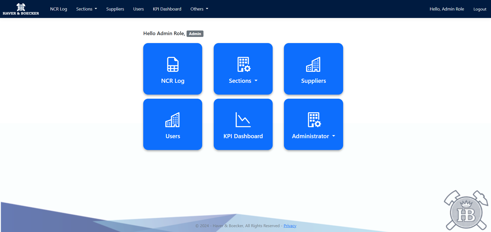
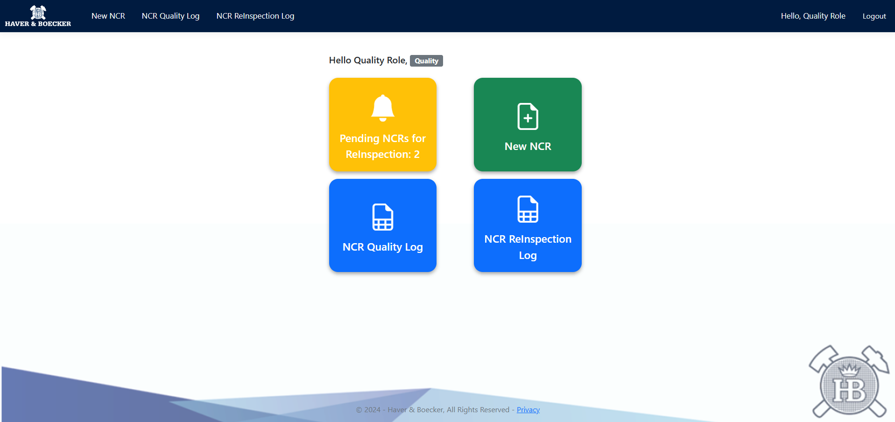
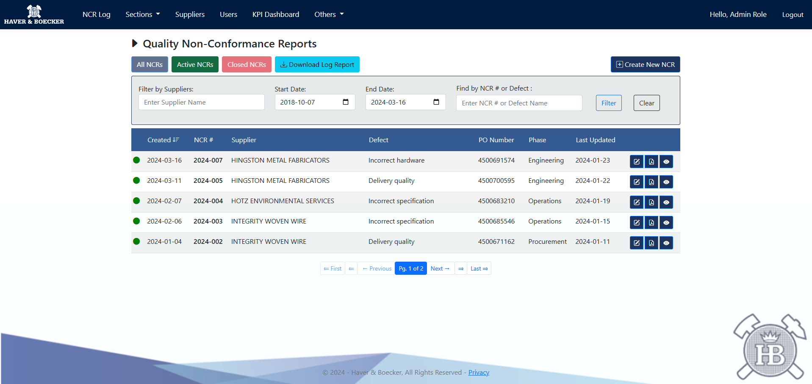
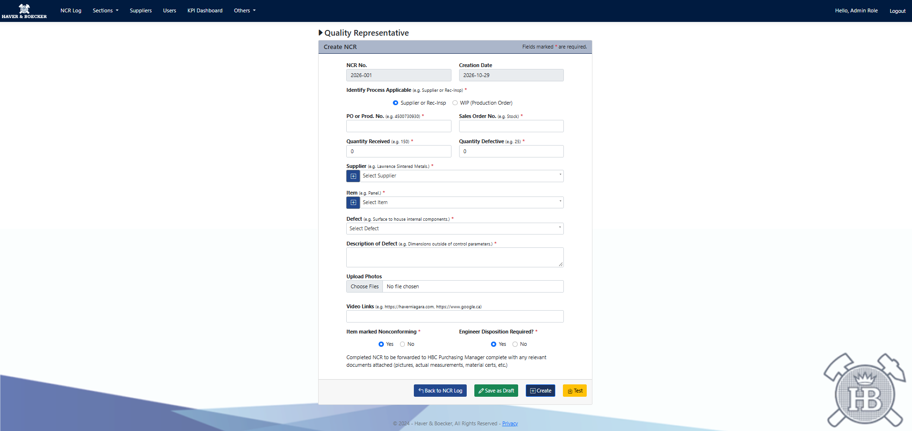
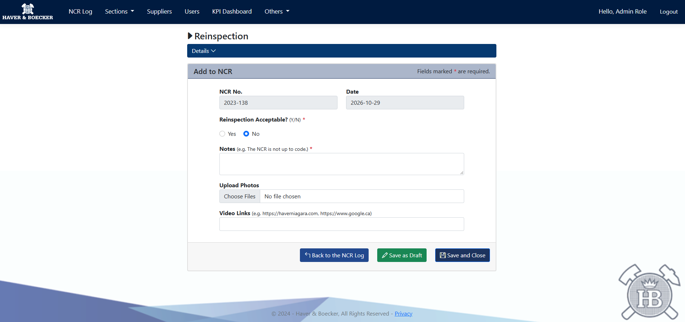
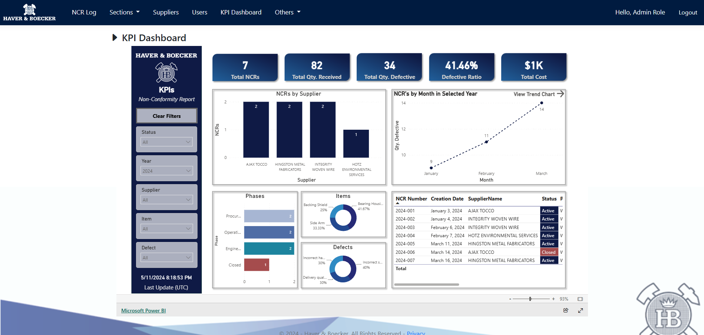

# NCR Creation/Modification Application Overview
This MVC application was developed as a team project during my Computer Programming studies at Niagara College, specifically for the [Community Sponsored Project](https://www.niagaracollege.ca/courses/PROG/1440/term/1281/plan/P0411/). We worked with Haver and Boecker Niagara to create a mock application for their NCR (Non-Conformance Report) creation process. The project was created to speed up their, at the time, current slow manual process to a streamlined digital version. In the end, our application was chosen #1 out of all the groups competing and would go on to be implemented into the business.

## Features
As mentioned, this application's main purpose is to assist in the NCR creation and tracking process. This process involves 5 major roles with those being Quality, Engineer, Operations, Procurement and Admin each with unique accessibility specific to their job in the workflow. 

Other features include the ability to upload, create, view and edit supplier and item records whenever needed, user account management, functionality that allows for an NCR to become archived or voided, downloadable PDF files of NCRs and supplier reports, and finally a KPI dashboard that details a large majority of sections for an Admin role to view. An email feature was implemented as well in order to notify the next role in the process that an NCR needed their attention, but I have removed that feature to protect sensitive information.

## Technologies
- C#
- ASP.NET Core MVC
- Entity Framework Core
- SQLite
- ASP.NET Core Identity
- Razor Views
- HTML, CSS, Javascript

## My Contribution
The primary areas of the application I contributed to were the reinspection functionality as well as the ability to upload an inspect uploaded images during the NCR process. Within the system, the reinspection process takes place at the end of the NCR creation period and allows a user with the quality role to review the entirety of the NCR process and either deem it acceptable or not. If the report is not acceptable, a notes section appears so the reasoning can be explained and then the NCR is closed with a new one being created right after to remake that specific report from the start. I added the functionality for uploading and viewing images so a user of any role could include additional information in terms of specific defects or measurements to the report for the next user or management to see. 

I also contributed to other areas of the application as needed, including assisting with additional sections as the team progressed. As this project was complete some time ago, I cannot reliably attribute every individual feature to myself. This repository represents the broader team's work rather than a project developed independently.

## Screenshots
Most Screenshots used in this section were taken from the perspective of the Admin role as they are able to see all sections and features of the application unless otherwise specified.
<br><br>
Once logged in, the home screen of the application is displayed:


This is an example of the Quality role home screen just to show the variations of interfaces depending on the users given role:
<br>


When starting the NCR process, a user with the Quality role will go to this page and can either create a new report or view, edit or download an existing NCR:
<br>


To create an NCR, this page will prompt the user to fill out all the required sections in order to generate the report and move it along in the chain (image zoomed out to encompass the page in it's entirety):


The section I helped create is the reinspection portion of the NCR lifecycle which has sections to be filled out as well as the ability, with the dropdown menu at the top of the page, to review the entire NCR for approval:


Finally, a section was added to allow the Admin to view a KPI dashboard that shows many important details about things like what phase NCRs are in, which suppliers have the reports to their name, which items are present the most in NCRs and so on:


## Setup Instructions

### Prerequisites
- Visual Studio with the ASP.NET and web development workload.
- The .NET 7 SDK version or higher.

### Steps
1. Clone or download this repository.
2. Open HaverNCRCollegeProject.sln in Visual Studio.
3. Allow NuGet to restore the project's dependencies if prompted.
4. Build the solution and run the application.
5. Log in using one of the provided demo accounts below to explore the application and see how the available views and permissions differ by role.

### Demo Accounts
All demo accounts use the same password: ```Pa55w@rd```
- ```Admin```: admin@example.com
- ```Quality```: quality@example.com
- ```Engineer```: engineer@example.com
- ```Operations```: operations@example.com
- ```Procurement```: procurement@example.com

```NOTE```: This project targets an unsupported .NET release and may require the corresponding runtime to run locally.
